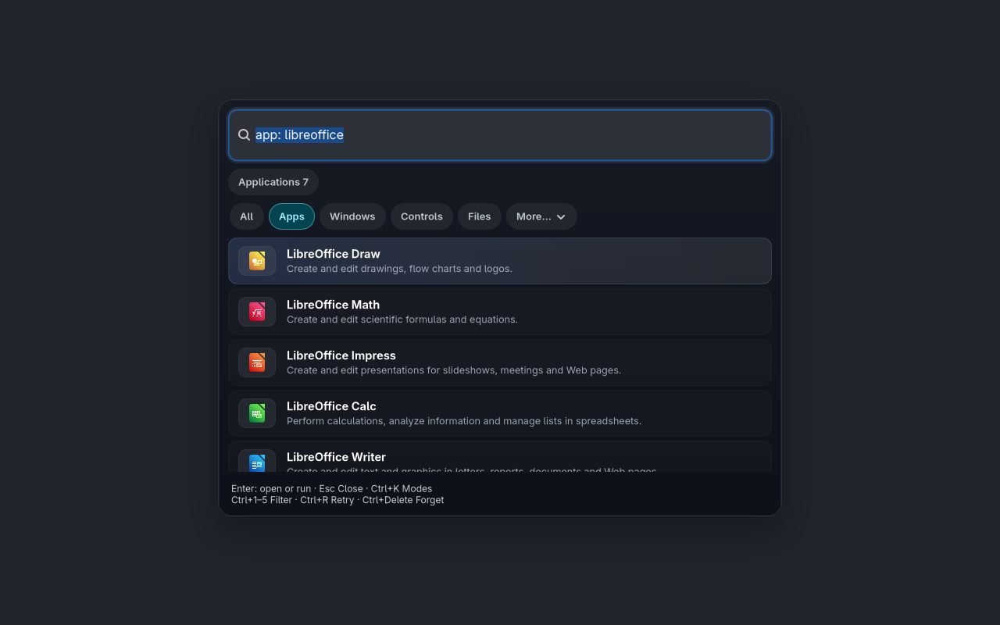
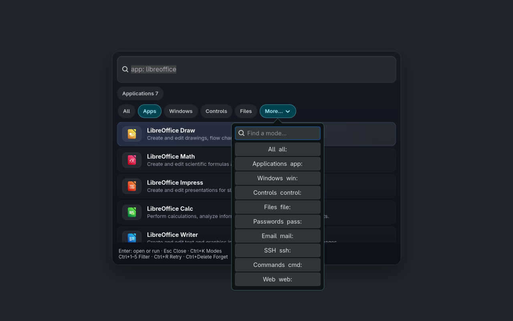

# Luma

A keyboard-driven launcher for Linux. Open applications, switch windows, search
files and email, run commands, and control your desktop from one search box.
Window switching supports Hyprland and Niri.

## Setup

Requires Rust, a C compiler, `pkg-config`, GTK 4.20+, and gtk4-layer-shell.
The build also requires Evolution and Evolution Data Server development
libraries (`evolution-mail-3.0`, `camel-1.2`, and `libedataserver-1.2`).

```sh
git clone https://github.com/robinp7720/Luma.git
cd Luma
cargo build --release --locked --bins
install -Dm755 target/release/Luma ~/.local/bin/Luma
install -Dm755 target/release/luma-mail-eds ~/.local/bin/luma-mail-eds
~/.local/bin/Luma
```

Add `~/.local/bin` to your `PATH` and bind `Luma --toggle` to a keyboard shortcut
in your compositor.

Optional tools enable additional sources: `localsearch` for indexed file search,
`pass` for passwords, `qalc` for calculations, and `cliphist` with `wl-copy` for
clipboard history. [Vigil](https://github.com/robinp7720/Vigil) adds shared desktop
controls, timers, and notification search. Evolution mail search is opt-in.

## Usage

Type to search, use the arrow keys to select a result, press Enter to open it,
and Escape to close. Ctrl+K opens the mode picker; Ctrl+1 through Ctrl+5 switch
between All, Apps, Windows, Controls, and Files.

```sh
Luma --mode windows
Luma --mode files --query report
Luma --query '25 * 4'
```

Type `settings` to configure sources and appearance. Settings are saved in
`~/.config/Luma/config.json`; CSS overrides go in `theme.css` or `style.css`
in the same directory. Run `Luma --help` for command-line options.

## Screenshots

Default settings and built-in styling, with GTK's Adwaita dark theme.




